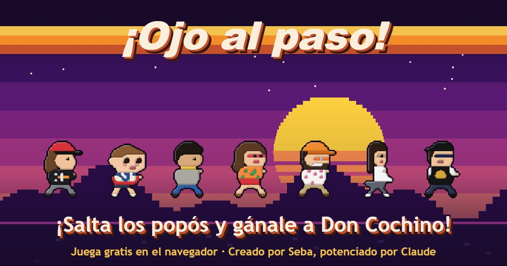

# ¡Ojo al paso!
Juego creado para mi sobrino. 

**Creado por Seba, potenciado por Claude.**



Juego de navegador para móvil (en horizontal): Rafa corre y salta popós hasta llegar a 9999 puntos y encontrar a Don Cochino. Supera tu récord y compártelo por WhatsApp.

🎮 **Jugar:** https://sebasromanh.github.io/ojo-al-paso/

Todo el juego está en `index.html`: gráficos pixel art y música chiptune generados con código, sin archivos externos.

## Jugar en tu computadora

Abre `index.html` en el navegador, o levanta un servidor local:

```bash
python -m http.server 8081
```

y entra a http://localhost:8081.

## Controles

- **Saltar:** tocar la pantalla, Espacio o ↑
- **Pausa:** botón II o Esc
- **Sonido:** botón del parlante o M
- **Pantalla completa:** botón de las esquinas o F

## Revisar que todo esté bien

```bash
node tests/validar.mjs
```

Para probar el juego con herramientas extra, abre `index.html?prueba`.

## Documentación

- La especificación y los acuerdos del equipo están en un repositorio privado.
- [Historial de cambios](CHANGELOG.md)

## Flujo de publicación

local → repo de pruebas (`ojo-al-paso-pruebas`) → producción (`ojo-al-paso`), ambos con GitHub Pages.

## Créditos

Creado por **Seba** (el Tío Seba), potenciado por **Claude**.
Protagonista: Rafa. Elenco: Baby Rafa, Tío Seba 80s, Vicky, Pipe, Angie y Francisco.
